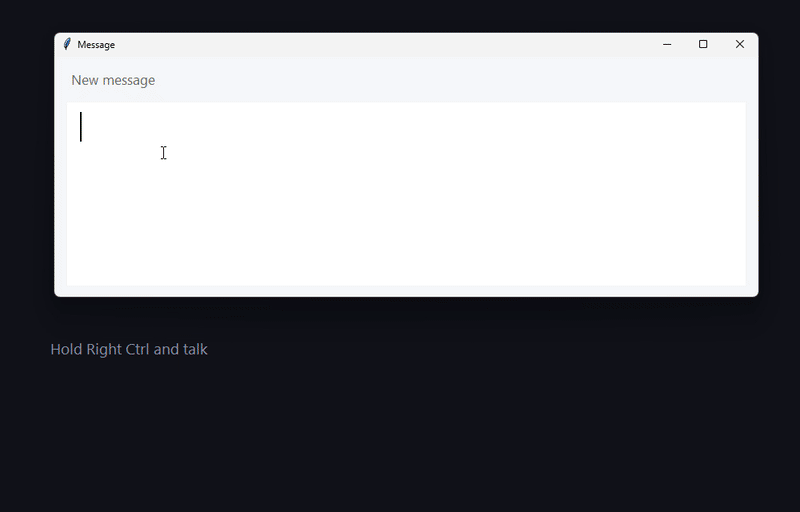
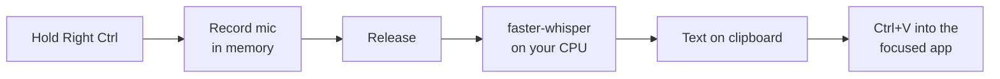
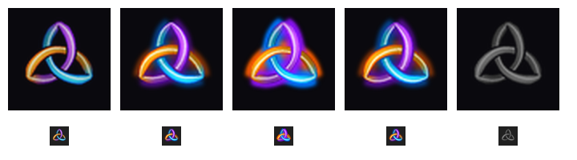

# Voice Anywhere

**Hold a key, speak, let go. Your words appear wherever your cursor is.**



<sub>A real recording, not a mock-up: the knot glows with the voice, then the transcription is pasted (the talking part is sped up).</sub>

Voice Anywhere is a small, free, private push-to-talk dictation tool for Windows. It works in any app: Teams, WhatsApp, Outlook, Word, a browser, VS Code, a terminal, or the chat box of an AI assistant such as GitHub Copilot, Claude or Microsoft Scout. Transcription runs **on your own machine**, so your voice never leaves it.

It's also an [Agent Skill](https://agentskills.io): give it to Claude Code, GitHub Copilot or any agent that reads `SKILL.md`, and the agent can install, tune and troubleshoot it for you.

## Why it's useful

- **Works everywhere.** Many apps and AI tools have their own voice button, and each one works differently, if it exists at all. Voice Anywhere is one habit that works in every text box.
- **Private by design.** Speech is turned into text locally with [faster-whisper](https://github.com/SYSTRAN/faster-whisper), an open-source implementation of OpenAI's Whisper model. No cloud speech service, no account, no recordings stored. That matters when you're dictating client or internal material.
- **Faster than typing.** Most people speak about three times faster than they type. It's great for long prompts to AI assistants, chat replies, email drafts and notes.
- **Multilingual.** It detects the language automatically (English, German, Dutch, French, Spanish and [many more](https://github.com/openai/whisper#available-models-and-languages)), or you can fix it with `--language`.
- **No lock-in, no cost.** MIT-licensed Python and open models, with nothing to subscribe to.
- **Easier on your hands.** It helps with RSI or when you're simply tired of typing. It can also read text aloud.
- **You stay in control.** It never presses Enter for you unless you ask it to, so you always read before you send.

## Tested by the squad

Voice Anywhere was reviewed by Superteam, Steve's AI agent squad, before this release, and the reports are in the repo:

| Reviewer | Role | Report |
|---|---|---|
| **Kryptonite** | Red team: security, privacy and whether the docs tell the truth | [2026-11-05-kryptonite.md](.squad/reviews/2026-11-05-kryptonite.md) |
| **Vera** (thread V1) | Quality gate: code review, unit tests and about 75 edge cases | [2026-11-05-vera-v1.md](.squad/reviews/2026-11-05-vera-v1.md) |
| **Vera** (thread V2) | Quality gate: a fresh install from GitHub in a sandbox, as a stranger would | [2026-11-05-vera-v2.md](.squad/reviews/2026-11-05-vera-v2.md) |
| **Vera** (re-test) | Re-checked every fix and gave the final sign-off | [2026-11-05-vera-signoff.md](.squad/reviews/2026-11-05-vera-signoff.md) |

The first version (0.1.0) went public without that review, and the squad caught real problems. The critical one: the default key, Right Ctrl, also fired on **Left** Ctrl, because the keyboard library gives both keys the same scan code. Every Ctrl+C opened the microphone. Version 0.2.0 fixes that and every other finding except two that were accepted with reasons; the [fix log](.squad/reviews/2026-11-05-fix-log.md) maps each finding to its fix and regression test.

## How it works



A global key listener watches for the talk key and matches it exactly, so Right Ctrl never reacts to Left Ctrl. Using the talk key as part of a shortcut (such as Right Ctrl + C) cancels the recording. While you hold the key, audio from your microphone is buffered in memory. When you let go, the speech model transcribes it locally (typically 1–2 seconds for a sentence with the default `base` model on a modern laptop). The text is then pasted into the window you were in when you pressed the key. If you've switched to another window in the meantime, nothing is pasted: the text waits on the clipboard instead, and a low chime tells you. Read-aloud copies your selection, speaks it with the built-in Windows voice (SAPI) and puts your clipboard back.

## Install

You need Windows 10 or 11, a microphone and [Python 3.12+](https://www.python.org/downloads/) (tick *Add python.exe to PATH*). No admin rights are needed.

```powershell
git clone https://github.com/stevemarksava/voice-anywhere
cd voice-anywhere\plugins\voice-anywhere\skills\voice-anywhere
powershell -ExecutionPolicy Bypass -File scripts\install.ps1 -Startup -SelfTest
```

That's it. It's now **always on**: it runs hidden in the background (no window), starts by itself every time you sign in, and you never have to think about it. When it's ready, the Trinity knot glows briefly at the bottom of your screen.

The installer sets up a private Python environment in `%LOCALAPPDATA%\voice-anywhere`, installs exact pinned versions of the dependencies (the ones the squad tested) and runs a self-test that needs no microphone. The test makes the Windows voice say a sentence, transcribes it and should print `SELF-TEST PASSED`. The speech model (about 145 MB) downloads once, on first run. Running the installer again upgrades in place; it only ever stops the copy it installed.

Installer options:

| Switch | Effect |
|---|---|
| `-Startup` | **Always on (recommended):** starts hidden at every sign-in, and starts it now |
| `-Shortcut` | Desktop shortcut that runs it in a visible window (handy for watching what it hears) |
| `-Arguments '--key f9 --language en'` | Default options for both |
| `-SelfTest` | Verify the install |
| `-Uninstall` | Remove it completely (see below) |

In always-on mode:

- Only one copy ever runs.
- After an error it restarts itself, waiting longer each time (up to 10 minutes). After three failures in a row it shows a message, so it never looks "on" while it's actually broken.
- Timings and lengths are logged to `%LOCALAPPDATA%\voice-anywhere\voice-anywhere.log`, **never what you said**.
- **Ctrl + Alt + Q** turns it off until your next sign-in.

**To uninstall:**

```powershell
powershell -ExecutionPolicy Bypass -File scripts\install.ps1 -Uninstall
```

This stops it and removes the install folder, the shortcuts and its tray-icon registry entry. The speech model stays in the shared Hugging Face cache (`%USERPROFILE%\.cache\huggingface\hub\models--Systran--faster-whisper-*`) because other apps may use it; delete those folders to free the space.

### As an Agent Skill

**Claude Code** (plugin marketplace):

```text
/plugin marketplace add https://github.com/stevemarksava/voice-anywhere
/plugin install voice-anywhere@voice-anywhere
```

**GitHub Copilot CLI:**

```bash
copilot plugin marketplace add stevemarksava/voice-anywhere
copilot plugin install voice-anywhere@voice-anywhere
```

**Any agent, by copying:** copy `plugins/voice-anywhere/skills/voice-anywhere/` to `.github/skills/` or `.claude/skills/` (in a project), or to `~/.claude/skills/`. Then ask your agent to *"set up Voice Anywhere for me"*. Other tools that read `SKILL.md` skills work the same way: Gemini CLI (`~/.gemini/skills/`), Cursor, and OpenAI Codex.

**On a company-managed laptop:** your organisation may only allow plugins from approved marketplaces, and then `marketplace add` fails with "blocked by enterprise policy". Use the copy method above, or ask your admin to add `stevemarksava/voice-anywhere` to the allowed sources.

## Use

### Is it on? Look for the knot



**While you talk,** a large Trinity knot floats at the bottom-centre of your screen, above the taskbar.


It glows and pulses with your voice, and its colours dim when you go quiet. It disappears once your text is pasted. Clicks pass straight through it, and it never takes focus, so the app you're typing in stays active. You also hear a soft rising chime the moment the microphone is live (the cue to start speaking), and a falling chime when you let go.

**The rest of the time,** a small knot sits in the taskbar's notification area:

| Knot | Meaning |
|---|---|
| **Dim colours** | On and waiting. Hold the key to talk. |
| **Glowing, pulsing with your voice** | Listening. The louder you speak, the brighter it glows, so you can see the mic is picking you up. |
| **Steady glow** | Transcribing. Your text arrives in a second or two. |
| **Grey** | Paused, or starting up. |

Right-click the knot to pause or resume, toggle auto-send, open the log or quit. Hover over it to see the current state. On Windows 11 the knot pins itself to the visible taskbar from the second start. If it's hidden under the **^** arrow, drag it out or turn it on in *Settings > Personalisation > Taskbar > Other system tray icons*.

### Keys

Start **Voice Anywhere** if it isn't already running (with `-Startup` it always is). With the desktop shortcut, a small console window opens; leave it running.

| Do this | What happens |
|---|---|
| Click into any text box, **hold Right Ctrl**, wait for the chime, speak, release | Text is pasted at the cursor and also left on the clipboard. |
| Select text, press **Ctrl + Alt + R** | It's read aloud. Markdown and links are tidied up first, and your clipboard is left as it was. If nothing is selected, nothing is read. |
| **Ctrl + Alt + S** | Stop reading |
| **Ctrl + Alt + Q** | Quit |

Tips:

- **Hold the key for the whole sentence.** Pauses are fine.
- **Teach it your words** with `--vocab "Avanade, Copilot, Fabric, Kubernetes"`.
- **Pick the right key.** Avoid combinations that other apps already use (e.g. Ctrl+Alt+Space opens some AI assistants). A single key such as Right Ctrl, F9 or Scroll Lock works best.

### Options

```text
--key KEY            key to hold while talking (default: right ctrl; matched exactly)
--model NAME         tiny | base | small | medium | large-v3 (default: base)
--language CODE      en, de, nl, fr, ... (default: auto-detect)
--vocab "A, B, C"    names and jargon to help recognition
--threads N          CPU threads, 1-64 (default: half your cores, max 8)
--device cpu|cuda|auto  use an NVIDIA GPU if available
--mic N|NAME         choose a microphone (see --list-mics)
--type               type key by key instead of pasting
--restore-clipboard  put your previous clipboard back after pasting
--auto-send          press Enter after pasting (skipped in standalone terminal windows)
--no-read, --no-beep turn off read-aloud or chimes
--chime-volume 0..1  chime loudness (default 0.35)
--overlay MODE       big knot while talking: bottom (default) | cursor | off
--overlay-size PX    size of the big knot, 64-1024 (default 260)
--no-tray            no Trinity-knot tray icon
--read-key / --stop-key / --quit-key   change the other hotkeys
--list-mics          list microphones
--background         always-on mode (hidden, single instance, self-restarting, logs to file)
--log FILE           write a log file (timings and lengths only, never your words)
--self-test          verify the install without a microphone
--version            show the version
```

### Choosing a model

Speed below was measured on one machine (a 24-thread laptop CPU, a 7-second sentence, 8 threads). Yours will differ, so run `--self-test` to see your own numbers:

| Model | Download | Speed | Accuracy |
|---|---|---|---|
| `tiny` | 75 MB | fastest | fine for clear speech |
| `base` (default) | 145 MB | ≈1.4 s | good everyday choice |
| `small` | 470 MB | ≈4.8 s | noticeably better with accents, names and mixed languages |
| `medium` / `large-v3` | 1.5 / 3 GB | slow on CPU | best; use with `--device cuda` |

## Privacy and security

- Your microphone audio is captured **only while the key is held**, kept in memory and never written to disk. (The `--self-test` makes a short computer-voice clip in your temp folder and deletes it straight away; it's not your voice.)
- Transcription is fully local. **No audio or text is sent anywhere.**
- Log files record timings and lengths only, **never what you said**, in every mode.
- The only network access is the one-time model download from Hugging Face (`Systran/faster-whisper-*`). If your network blocks it, set `HF_ENDPOINT` to an internal mirror.
- It uses a global keyboard hook (the [`keyboard`](https://github.com/boppreh/keyboard) package) to detect the talk key. It acts only on the configured keys; while the talk key is held it also notices whether any other key goes down (to cancel shortcuts), but it never records or stores which key.
- Text is only pasted into the window you were in when you pressed the key. `--auto-send` never presses Enter in a standalone terminal window, where that could run a command. Terminals built into editors (such as VS Code's) can't be told apart from the editor, so don't use `--auto-send` there.
- The transcript is placed on the clipboard, so clipboard history or sync tools may keep it. Use `--restore-clipboard` to limit this.
- To pin its tray icon to the taskbar, it sets one value (`IsPromoted`) under `HKCU\Control Panel\NotifyIconSettings`. `-Uninstall` removes its whole entry there.
- Dependencies are pinned to the exact versions the squad tested. The `keyboard` package is no longer actively maintained (last release 2021); it works on current Windows, but it's the part to watch.

**On a managed work laptop:** a global keyboard hook, clipboard automation and a background Python process together look a lot like a keylogger to endpoint-security tools (Microsoft Defender for Endpoint, CrowdStrike and others). Your security tooling may flag or block it, and that's expected. The code is short and readable, so check it, or ask your IT team before installing it on a corporate device.

## Troubleshooting

| Problem | Fix |
|---|---|
| Another app's pop-up flickers while you talk | Your talk key clashes with its shortcut. Use `--key f9` (or another single key). |
| Nothing gets pasted | Click into a text box first. If you switched windows while it was transcribing, it deliberately doesn't paste (low chime); press Ctrl+V where you want the text. Admin windows ignore input from normal apps, so run Voice Anywhere as admin for those. Use `--type` for apps that block paste. |
| Slow | Use `--model base` or `tiny`, and try `--threads 4` or `8`. |
| Wrong words | Use `--model small`, `--language en`, `--vocab "..."` and a headset mic. |
| Silence | Check `--list-mics` and Windows *Settings > Privacy > Microphone > Let desktop apps access your microphone*. |
| The chime comes late or not at all on a Bluetooth headset | Bluetooth headsets switch into a hands-free mode when the mic opens, which takes about half a second to a second. The chime plays only once the mic is really delivering audio, so wait for it before speaking. If you never hear it, watch the big knot instead (it brightens as soon as it hears you), or try `--chime-volume 0.6`. |
| Is it running? | Look for the Trinity knot in the taskbar (dim = on). If it's not there, check under the **^** arrow and the log at `%LOCALAPPDATA%\voice-anywhere\voice-anywhere.log`, or start it from the desktop shortcut to watch it. |
| "Already running" | It's on in the background. Press Ctrl+Alt+Q to stop that copy first. |

## Development

```powershell
python -m unittest discover -s tests -v                                   # pure-logic tests; Pillow/numpy tests skip if not installed
python plugins\voice-anywhere\skills\voice-anywhere\scripts\voice_anywhere.py --self-test   # end-to-end (needs requirements)
```

See [CONTRIBUTING.md](CONTRIBUTING.md).

## Credits

- The Trinity knot mark is by Steve Marks: one unbroken flame in three colours.
- [faster-whisper](https://github.com/SYSTRAN/faster-whisper) (MIT) and [OpenAI Whisper](https://github.com/openai/whisper) models (MIT)
- [keyboard](https://github.com/boppreh/keyboard) (MIT), [sounddevice](https://github.com/spatialaudio/python-sounddevice) (MIT), [pyperclip](https://github.com/asweigart/pyperclip) (BSD), [pywin32](https://github.com/mhammond/pywin32) (PSF), [Pillow](https://github.com/python-pillow/Pillow) (MIT-CMU)
- [pystray](https://github.com/moses-palmer/pystray) (LGPL-3.0). It is installed separately from PyPI and used unmodified as a library; it isn't bundled into this repo. Under the LGPL you're free to replace it with any other version: `pip install pystray==<version>` in the install's `.venv`.

## License

[MIT](LICENSE)
