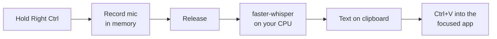

# Voice Anywhere

**Hold a key, speak, let go. Your words appear wherever your cursor is.**

Voice Anywhere is a small, free, private push-to-talk dictation tool for Windows. It works in any app: Teams, WhatsApp, Outlook, Word, a browser, VS Code, a terminal, or the chat box of an AI assistant such as GitHub Copilot, Claude or Microsoft Scout. Transcription runs **on your own machine**, so your voice never leaves it.

It's also an [Agent Skill](https://agentskills.io): give it to Claude Code, GitHub Copilot or any agent that reads `SKILL.md`, and the agent can install, tune and troubleshoot it for you.

## Why it's useful

- **Works everywhere.** Many apps and AI tools have their own voice button, and each one works differently, if it exists at all. Voice Anywhere is one habit that works in every text box.
- **Private by design.** Speech is turned into text locally with [faster-whisper](https://github.com/SYSTRAN/faster-whisper), an open-source implementation of OpenAI's Whisper model. No cloud speech service, no account, no recordings stored. That matters when you're dictating client or internal material.
- **Faster than typing.** Most people speak about three times faster than they type. It's great for long prompts to AI assistants, chat replies, email drafts and notes.
- **Multilingual.** It detects the language automatically (English, German, Dutch, French, Spanish and [many more](https://github.com/openai/whisper#available-models-and-languages)), or you can fix it with `--language`.
- **No lock-in, no cost.** MIT-licensed Python and open models, with nothing to subscribe to.
- **Easier on your hands.** It helps with RSI or when you're simply tired of typing. It can also read text aloud.
- **You stay in control.** It never presses Enter for you unless you ask it to, so you always read before you send.

## How it works



A global key listener watches for the talk key. While you hold it, audio from your microphone is buffered in memory. When you let go, the speech model transcribes it locally (typically 1–2 seconds for a sentence with the default `base` model on a modern laptop). The text is then pasted into whatever window has focus. Read-aloud copies your selection and speaks it with the built-in Windows voice (SAPI).

## Install

You need Windows 10 or 11, a microphone and [Python 3.9+](https://www.python.org/downloads/) (tick *Add python.exe to PATH*). No admin rights are needed.

```powershell
git clone https://github.com/stevemarksava/voice-anywhere
cd voice-anywhere\plugins\voice-anywhere\skills\voice-anywhere
powershell -ExecutionPolicy Bypass -File scripts\install.ps1 -Startup -SelfTest
```

That's it. It's now **always on**: it runs hidden in the background (no window), starts by itself every time you sign in, and you never have to think about it. A double beep tells you it's ready.

The installer sets up a private Python environment in `%LOCALAPPDATA%\voice-anywhere` and runs a self-test that needs no microphone. The test makes the Windows voice say a sentence, transcribes it and should print `SELF-TEST PASSED`. The speech model (about 145 MB) downloads once, on first run.

Installer options:

| Switch | Effect |
|---|---|
| `-Startup` | **Always on (recommended):** starts hidden at every sign-in, and starts it now |
| `-Shortcut` | Desktop shortcut that runs it in a visible window (handy for watching what it hears) |
| `-Arguments '--key f9 --language en'` | Default options for both |
| `-SelfTest` | Verify the install |

In always-on mode:

- Only one copy ever runs.
- After an error it restarts itself.
- What it hears is logged to `%LOCALAPPDATA%\voice-anywhere\voice-anywhere.log`.
- **Ctrl + Alt + Q** turns it off until your next sign-in.

**To uninstall,** press Ctrl + Alt + Q, then delete `%LOCALAPPDATA%\voice-anywhere`, the desktop shortcut and `Voice Anywhere` in your Startup folder (`shell:startup`).

### As an Agent Skill

**Claude Code** (plugin marketplace):

```text
/plugin marketplace add https://github.com/stevemarksava/voice-anywhere
/plugin install voice-anywhere@voice-anywhere
```

**GitHub Copilot CLI:**

```bash
copilot plugin marketplace add stevemarksava/voice-anywhere
copilot plugin install voice-anywhere@voice-anywhere
```

**Any agent, by copying:** copy `plugins/voice-anywhere/skills/voice-anywhere/` to `.github/skills/` or `.claude/skills/` (in a project), or to `~/.claude/skills/`. Then ask your agent to *"set up Voice Anywhere for me"*.

## Use

### Is it on? Look for the knot


A Trinity knot sits in the taskbar's notification area:

| Knot | Meaning |
|---|---|
| **Dim colours** | On and waiting. Hold the key to talk. |
| **Glowing, pulsing with your voice** | Listening. The louder you speak, the brighter it glows, so you can see the mic is picking you up. |
| **Steady glow** | Transcribing. Your text arrives in a second or two. |
| **Grey** | Paused, or starting up. |

Right-click the knot to pause or resume, toggle auto-send, open the log or quit. Hover over it to see the current state. On Windows 11 the knot pins itself to the visible taskbar from the second start. If it's hidden under the **^** arrow, drag it out or turn it on in *Settings > Personalisation > Taskbar > Other system tray icons*.

### Keys

Start **Voice Anywhere** if it isn't already running (with `-Startup` it always is). With the desktop shortcut, a small console window opens; leave it running.

| Do this | What happens |
|---|---|
| Click into any text box, **hold Right Ctrl**, speak, release | Text is pasted at the cursor and also left on the clipboard. Beeps mark start and stop. |
| Select text, press **Ctrl + Alt + R** | It's read aloud. Markdown and links are tidied up first. |
| **Ctrl + Alt + S** | Stop reading |
| **Ctrl + Alt + Q** | Quit |

Tips:

- **Hold the key for the whole sentence.** Pauses are fine.
- **Teach it your words** with `--vocab "Avanade, Copilot, Fabric, Kubernetes"`.
- **Pick the right key.** Avoid combinations that other apps already use (e.g. Ctrl+Alt+Space opens some AI assistants). A single key such as Right Ctrl, F9 or Scroll Lock works best.

### Options

```text
--key KEY            key to hold while talking (default: right ctrl)
--model NAME         tiny | base | small | medium | large-v3 (default: base)
--language CODE      en, de, nl, fr, ... (default: auto-detect)
--vocab "A, B, C"    names and jargon to help recognition
--threads N          CPU threads (default: half your cores, max 8)
--device cpu|cuda    use an NVIDIA GPU if available
--mic N|NAME         choose a microphone (see --list-mics)
--type               type key by key instead of pasting
--restore-clipboard  put your previous clipboard back after pasting
--auto-send          press Enter after pasting
--no-read, --no-beep turn off read-aloud or beeps
--no-tray            no Trinity-knot tray icon
--read-key / --stop-key / --quit-key   change the other hotkeys
--list-mics          list microphones
--background         always-on mode (hidden, single instance, self-restarting, logs to file)
--log FILE           write output to a log file
--self-test          verify the install without a microphone
```

### Choosing a model

Speed was measured on a 24-thread laptop CPU, transcribing a 7-second sentence with 8 threads:

| Model | Download | Speed | Accuracy |
|---|---|---|---|
| `tiny` | 75 MB | fastest | fine for clear speech |
| `base` (default) | 145 MB | ≈1.4 s | good everyday choice |
| `small` | 470 MB | ≈4.8 s | noticeably better with accents, names and mixed languages |
| `medium` / `large-v3` | 1.5 / 3 GB | slow on CPU | best; use with `--device cuda` |

## Privacy and security

- Audio is captured **only while the key is held**, kept in memory and never written to disk.
- Transcription is fully local. **No audio or text is sent anywhere.**
- The always-on log records timings and lengths only, **never what you said**.
- The only network access is the one-time model download from Hugging Face (`Systran/faster-whisper-*`). If your network blocks it, set `HF_ENDPOINT` to an internal mirror.
- It uses a global keyboard hook (the [`keyboard`](https://github.com/boppreh/keyboard) package) to detect the talk key. It reacts only to the configured keys and logs nothing. Some security tools flag keyboard hooks, which is expected.
- The transcript is placed on the clipboard, so clipboard history or sync tools may keep it. Use `--restore-clipboard` to limit this.

## Troubleshooting

| Problem | Fix |
|---|---|
| Another app's pop-up flickers while you talk | Your talk key clashes with its shortcut. Use `--key f9` (or another single key). |
| Nothing gets pasted | Click into a text box first. Admin windows ignore input from normal apps, so run Voice Anywhere as admin for those. Use `--type` for apps that block paste. |
| Slow | Use `--model base` or `tiny`, and try `--threads 4` or `8`. |
| Wrong words | Use `--model small`, `--language en`, `--vocab "..."` and a headset mic. |
| Silence | Check `--list-mics` and Windows *Settings > Privacy > Microphone > Let desktop apps access your microphone*. |
| Is it running? | Look for the Trinity knot in the taskbar (dim = on). If it's not there, check under the **^** arrow and the log at `%LOCALAPPDATA%\voice-anywhere\voice-anywhere.log`, or start it from the desktop shortcut to watch it. |
| "Already running" | It's on in the background. Press Ctrl+Alt+Q to stop that copy first. |

## Development

```powershell
python -m unittest discover -s tests -v                                   # pure-logic tests, no deps needed
python plugins\voice-anywhere\skills\voice-anywhere\scripts\voice_anywhere.py --self-test   # end-to-end (needs requirements)
```

See [CONTRIBUTING.md](CONTRIBUTING.md).

## Credits

- The Trinity knot mark is by Steve Marks: one unbroken flame in three colours.
- [faster-whisper](https://github.com/SYSTRAN/faster-whisper) (MIT) and [OpenAI Whisper](https://github.com/openai/whisper) models (MIT)
- [keyboard](https://github.com/boppreh/keyboard) (MIT), [sounddevice](https://github.com/spatialaudio/python-sounddevice) (MIT), [pyperclip](https://github.com/asweigart/pyperclip) (BSD), [pywin32](https://github.com/mhammond/pywin32) (PSF), [pystray](https://github.com/moses-palmer/pystray) (LGPL-3.0, used unmodified as a library), [Pillow](https://github.com/python-pillow/Pillow) (MIT-CMU)

## License

[MIT](LICENSE)
